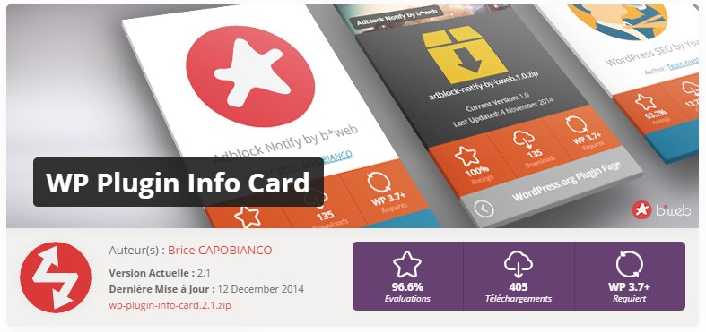

# WP Plugin Info Card, original versions

**The first versions of WP Plugin Info Card, 1.0 to 2.5.2 (November 2014 to March 2018), as I wrote them.**

WP Plugin Info Card shows a plugin or a theme from wordpress.org in a card on your site: icon, version, rating, downloads, last update, with a 3D flip to see the back. You give it a slug, it asks the wordpress.org API for the rest.

I created the plugin in 2014 and maintained it until 2018. Ronald Huereca ([ronalfy](https://profiles.wordpress.org/ronalfy/)) took it over in 2019 and has developed it since, starting with a Gutenberg block in 3.0. **This repository stops before that**: it holds the history of my versions only, and later versions are not here.

To use the plugin today, install the current version from wordpress.org: **[wordpress.org/plugins/wp-plugin-info-card](https://wordpress.org/plugins/wp-plugin-info-card/)**.

  
  

## What 2.5.2 does

- **`[wp-pic]`** displays one plugin or theme: `[wp-pic slug="wp-plugin-info-card"]`, or `[wp-pic type="theme" slug="twentyseventeen"]`. Three layouts (`card`, `large`, `wordpress`), ten color schemes, alignment, margins, AJAX loading. With `custom="downloaded"` it returns a single value you can drop into a sentence.
- **`[wp-pic-query]`** (added in 2.5) displays a list from a search, a tag, an author, a user's favorites or a wordpress.org browse page such as `popular`, in one, two or three columns.
- **A dashboard widget** that follows the plugins and themes you pick in the settings, handy to keep an eye on your own.
- **A shortcode builder** in the classic editor's toolbar.

The full list of parameters is in `readme.txt`. API answers are kept in transients, so a page with cards doesn't call wordpress.org on every visit. Scripts and styles only load on pages that use a card.

## Requirements

WordPress 3.7 or newer. The last version here, 2.5.2, was tested up to WordPress 4.9.4.

## History

The history comes from the plugin's SVN repository on wordpress.org and stops at my last commit, in March 2018. Each version published in that period has its own tag, from `1.0` to `2.5.2`. The banner, icon and screenshots in `.wordpress-org/` are those of the plugin page at that time.

The French version of this file is `README_FR.md`.

## License

GPLv2 or later, see `LICENSE`.
