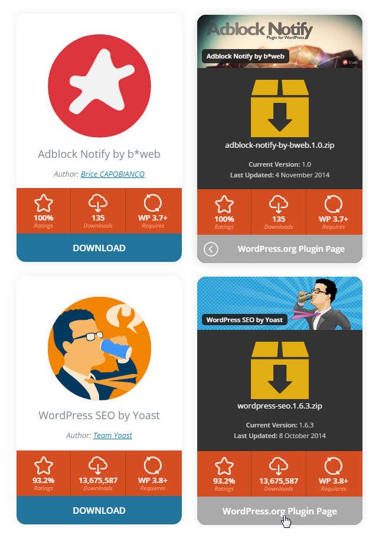
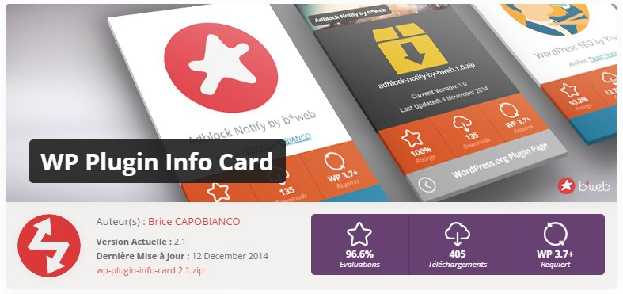

# WP Plugin Info Card, versions d'origine

**Les premières versions de WP Plugin Info Card, de la 1.0 à la 2.5.2 (novembre 2014 à mars 2018), telles que je les ai écrites.**

WP Plugin Info Card affiche un plugin ou un thème de wordpress.org dans une carte sur votre site : icône, version, note, téléchargements, dernière mise à jour, avec une rotation 3D pour voir le dos. Vous donnez un slug, il demande le reste à l'API de wordpress.org.

J'ai créé ce plugin en 2014 et je l'ai maintenu jusqu'en 2018. Ronald Huereca ([ronalfy](https://profiles.wordpress.org/ronalfy/)) l'a repris en 2019 et le développe depuis, à commencer par un bloc Gutenberg en 3.0. **Ce dépôt s'arrête avant** : il ne contient que l'historique de mes versions, les suivantes n'y sont pas.

Pour utiliser le plugin aujourd'hui, installez la version actuelle depuis wordpress.org : **[wordpress.org/plugins/wp-plugin-info-card](https://fr.wordpress.org/plugins/wp-plugin-info-card/)**.

  
  

## Ce que fait la 2.5.2

- **`[wp-pic]`** affiche un plugin ou un thème : `[wp-pic slug="wp-plugin-info-card"]`, ou `[wp-pic type="theme" slug="twentyseventeen"]`. Trois mises en page (`card`, `large`, `wordpress`), dix jeux de couleurs, alignement, marges, chargement en AJAX. Avec `custom="downloaded"`, il renvoie une seule valeur à glisser dans une phrase.
- **`[wp-pic-query]`** (ajouté en 2.5) affiche une liste issue d'une recherche, d'un tag, d'un auteur, des favoris d'un utilisateur ou d'une page de wordpress.org comme `popular`, sur une, deux ou trois colonnes.
- **Un widget de tableau de bord** qui suit les plugins et thèmes choisis dans les réglages, pratique pour surveiller les siens.
- **Un générateur de shortcode** dans la barre d'outils de l'éditeur classique.

La liste complète des paramètres est dans `readme.txt`. Les réponses de l'API sont gardées en transients : une page avec des cartes n'appelle pas wordpress.org à chaque visite. Scripts et styles ne se chargent que sur les pages qui affichent une carte.

## Prérequis

WordPress 3.7 ou plus récent. La dernière version de ce dépôt, la 2.5.2, a été testée jusqu'à WordPress 4.9.4.

## Historique

L'historique vient du dépôt SVN du plugin sur wordpress.org et s'arrête à mon dernier commit, en mars 2018. Chaque version publiée sur cette période a son tag, de `1.0` à `2.5.2`. La bannière, l'icône et les captures de `.wordpress-org/` sont celles de la page du plugin à cette époque.

La version anglaise de ce fichier est `README.md`.

## Licence

GPLv2 ou ultérieure, voir `LICENSE`.
